<picture>
  <source media="(prefers-color-scheme: dark)" srcset="assets/hero-dark.svg">
  
</picture>

# AI Engineer | Developing Intelligent Systems at the Intersection of Data Science, Agentic AI & Business Intelligence

I build tools for exploring data and finding research. I’m interested in how a model’s predictions can be explained and how people use them in software.

## Selected engineering work

| Project | What to inspect |
| --- | --- |
| [CogniSight](https://github.com/misbahulhaque1/CogniSight-Streamlit-Student-Performance-Analyzer) | A Python and Streamlit application that uses a scikit-learn random forest to classify student performance as High, Medium, or Low from 13 numeric inputs. |
| [AI Research Paper Hub](https://github.com/misbahulhaque1/AI-RESEARCH-PAPER-HUB/tree/main/rpp_fixed) | A research discovery application with a React interface, OpenAlex ingestion and separate search, recommendation and summary services. |

## Research and engineering interests

Explainable classification · AI for cybersecurity · Document intelligence · Information retrieval

[Public projects and contribution activity](https://github.com/misbahulhaque1?tab=overview) · [Research Hub discussions and feedback via issues](https://github.com/misbahulhaque1/AI-RESEARCH-PAPER-HUB/issues)

[Connect on LinkedIn](https://www.linkedin.com/in/misbahulhaque001/)
